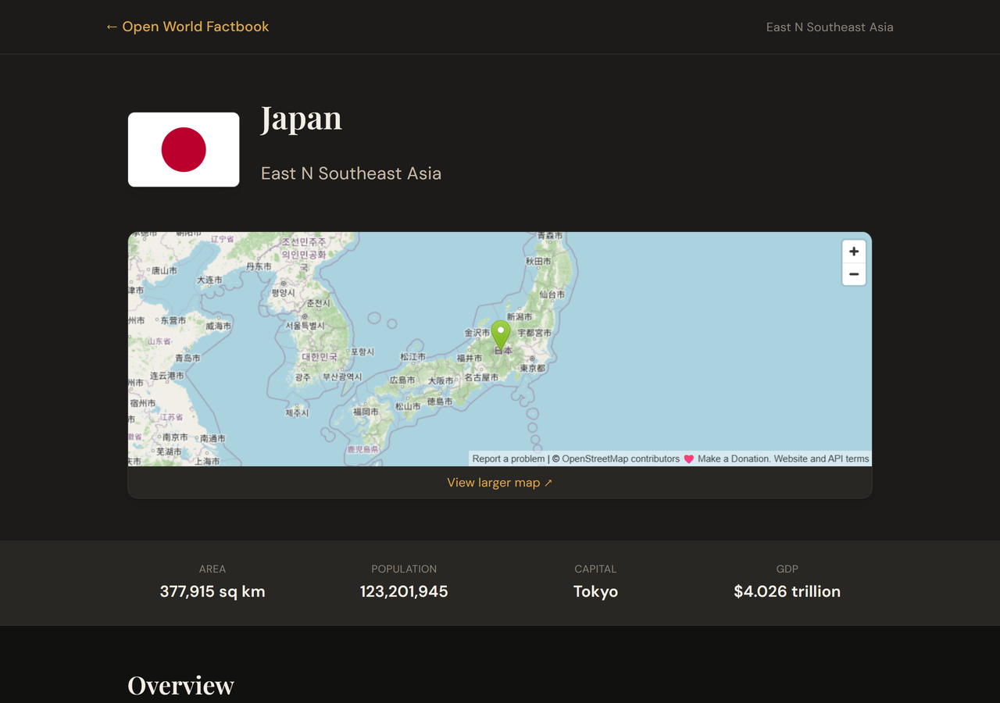
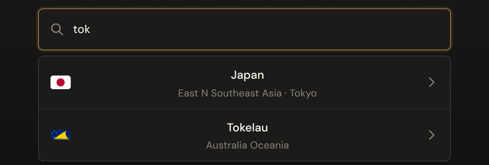
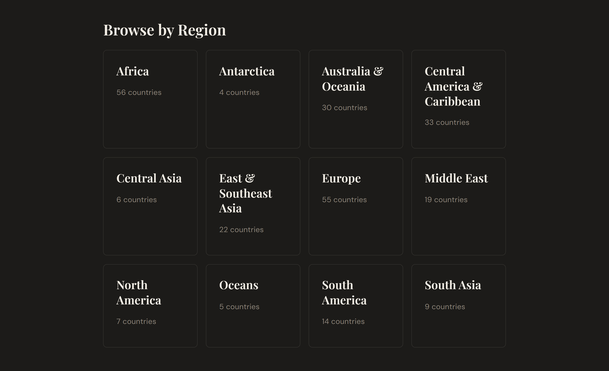

# Open World Factbook

Search and read country profiles from public-domain data.

Live: <https://worldfactbook.xyz>



Each country and territory has one page with a flag, a map and its full profile.
The same data is plain JSON in this repo, so you can read it with no API key.

## What it does

- Search countries, capitals and regions from the home page.
- Browse by region, or read the full A to Z list.
- Open a profile with geography, people, government, economy and more.
- Fetch any profile as raw JSON.

<table>
  <tr>
    <td width="50%"></td>
    <td width="50%"></td>
  </tr>
  <tr>
    <td>Search matches names and capitals as you type.</td>
    <td>Browse by region.</td>
  </tr>
</table>

## The data

The `data/` folder holds 260 profiles in 12 region folders, plus one file for the
World. Each file is one country, territory or ocean. Files use the two-letter GEC
codes, so Germany is `gm.json`.
<!-- source: git tree of the master branch, read 2026-11-06 -->

The profiles come from [`factbook.json`](data/README.md), which converts the
[CIA World Factbook](https://www.cia.gov/the-world-factbook/) to JSON. That data is
in the public domain, and the `factbook.json` project releases its files under
[CC0](data/LICENSE.md).

There is no hosted API. Read a file straight from GitHub:

```sh
curl -s https://raw.githubusercontent.com/Jeff-Kazzee/open-world-factbook/master/data/north-america/us.json | head -c 400
```

<!-- tested: 2026-11-06, curl on Windows, no project files -->

Top-level sections are Introduction, Geography, People and Society, Environment,
Government, Economy, Energy, Communications, Transportation, Military and
Security, Space, Terrorism, and Transnational Issues.

## How it works

- [`src/lib/data.ts`](src/lib/data.ts) reads the JSON files from disk and builds the country index.
- `generateStaticParams` prerenders a page for each country at build time.
- [`SearchBar.tsx`](src/components/SearchBar.tsx) runs a fuzzy search in the browser with Fuse.js, over name, capital and region.
- Flags load from flagcdn.com. Maps are OpenStreetMap embeds.

## Run it

```sh
pnpm install
pnpm dev
```

<!-- tested: 2026-11-06, clean clone on Ubuntu, Node 24.22.1, pnpm 10.33.2 -->

Open `http://localhost:3000`.

## Stack

Next.js 16, React 19, TypeScript, Tailwind CSS 4 and Fuse.js, deployed on Vercel.

## Status

Deployed at <https://worldfactbook.xyz>. On 2026-11-06 the home, country, region,
about, API and contribute pages each returned HTTP 200.

- Works: home page search, region and country pages, and raw JSON from GitHub. Each was checked on 2026-11-06.
- Missing: a hosted API and automated tests.
- Data age: the CIA ended the Factbook in February 2026, so these profiles are a final snapshot. Figures carry their own year, such as `2024 est.` in the Japan file.

## License

No license file yet. Until one is added, the code has all rights reserved. The
data in `data/` is CC0. See [data/LICENSE.md](data/LICENSE.md).
