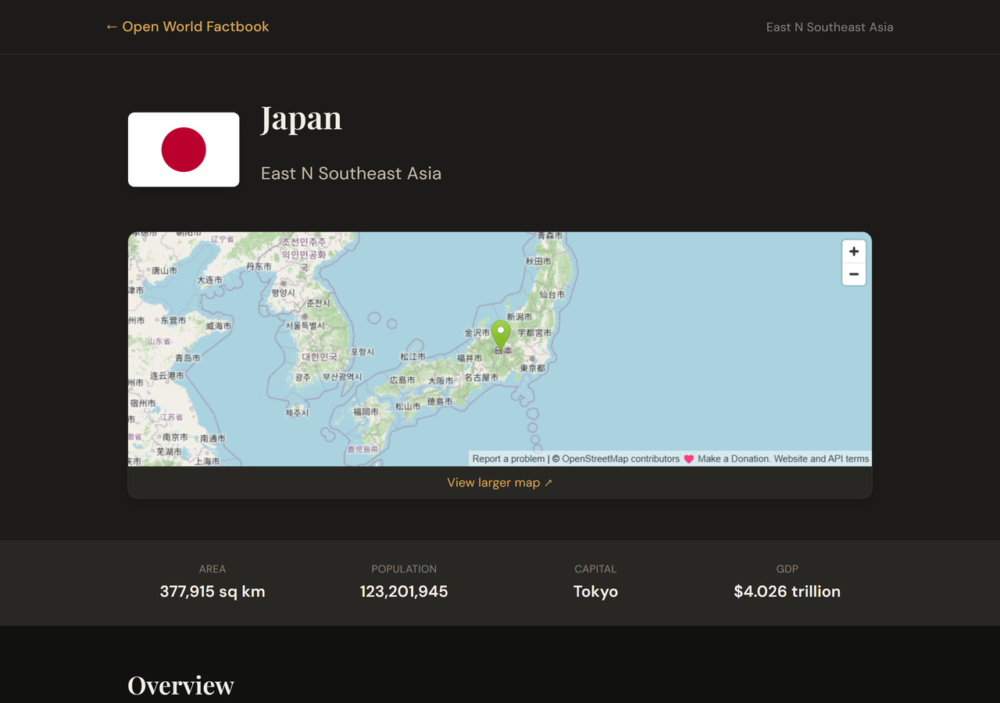
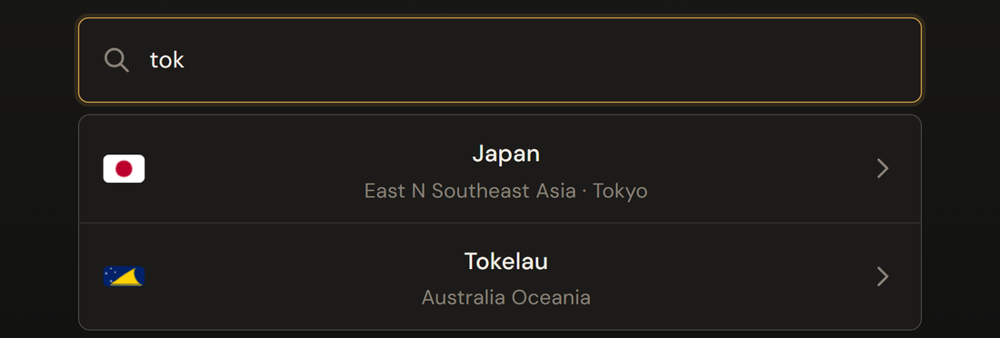
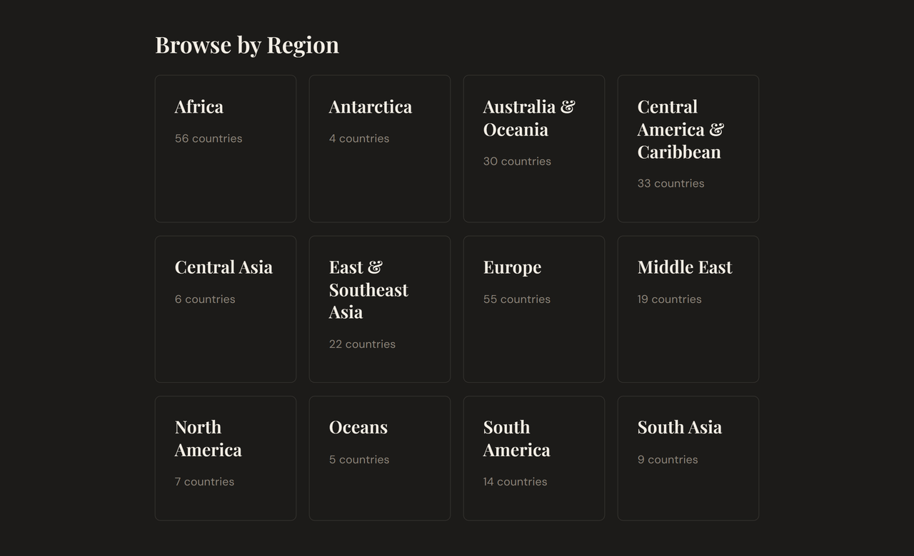

# Open World Factbook

Search and read country profiles from public-domain data.

Live: <https://worldfactbook.xyz>



Each country and territory has one page with a flag, a map and its full profile.
The same data is plain JSON in this repo, so you can read it with no API key.

## Features

- Search countries, capitals and regions from the home page.
- Browse by region, or read the full A to Z list.
- Open a profile with geography, people, government, economy and more.
- Fetch any profile as raw JSON.

<table>
  <tr>
    <td width="50%"></td>
    <td width="50%"></td>
  </tr>
  <tr>
    <td>Search matches names and capitals as you type.</td>
    <td>Browse by region.</td>
  </tr>
</table>

## Quick start

The security-update validation used Linux with Node 24.22.3, npm 11.19.1 and
pnpm 11.28.6. These are validation versions, not a repository `engines` pin.

With pnpm:

```sh
pnpm install --ignore-scripts
pnpm build
```

After the build completes, run `pnpm dev` and open `http://localhost:3000`.
The development command uses the existing `dev` script in
[package.json](package.json).

`npm ci` installs the committed [package-lock.json](package-lock.json).
There is no committed `pnpm-lock.yaml`, so a fresh pnpm install can resolve a
different dependency graph. Its parent-scoped override is in
[pnpm-workspace.yaml](pnpm-workspace.yaml).

## Examples

### Find a country

Type a country or capital into the home-page search, then open its profile.
The screenshot above uses `tok`, matching Japan through Tokyo and Tokelau by
name.

### Read a JSON profile

There is no hosted API. Read a file straight from GitHub:

```sh
curl -s https://raw.githubusercontent.com/Jeff-Kazzee/open-world-factbook/master/data/north-america/us.json | head -c 400
```

<!-- tested: 2026-11-06, curl on Windows, no project files -->

### Use the committed npm lockfile

```sh
npm ci --ignore-scripts --no-fund
npm run build
```

After the build completes, run `npm run dev` to start the development server.

## Documentation

See [the dataset README](data/README.md) for its source and format. The data
layout and application entry points are described below.

## The data

The `data/` folder holds 260 profiles in 12 region folders, plus one file for the
World. Each file is one country, territory or ocean. Files use the two-letter GEC
codes, so Germany is `gm.json`.
<!-- source: git tree of the master branch, read 2026-11-06 -->

The profiles come from [`factbook.json`](data/README.md), which converts the
[CIA World Factbook](https://www.cia.gov/the-world-factbook/) to JSON. That data is
in the public domain, and the `factbook.json` project releases its files under
[CC0](data/LICENSE.md).

Top-level sections are Introduction, Geography, People and Society, Environment,
Government, Economy, Energy, Communications, Transportation, Military and
Security, Space, Terrorism, and Transnational Issues.

## How it works

- [`src/lib/data.ts`](src/lib/data.ts) reads the JSON files from disk and builds the country index.
- `generateStaticParams` prerenders a page for each country at build time.
- [`SearchBar.tsx`](src/components/SearchBar.tsx) runs a fuzzy search in the browser with Fuse.js, over name, capital and region.
- Flags load from flagcdn.com. Maps are OpenStreetMap embeds.

## Stack

Next.js 16, React 19, TypeScript, Tailwind CSS 4 and Fuse.js, deployed on Vercel.

## Status

Deployed at <https://worldfactbook.xyz>. On 2026-11-06 the home, country, region,
about, API and contribute pages each returned HTTP 200.

- Works: home page search, region and country pages, and raw JSON from GitHub. Each was checked on 2026-11-06.
- Missing: a hosted API and a `test` script in `package.json`.
- Data age: the CIA ended the Factbook in February 2026, so these profiles are a final snapshot. Figures carry their own year, such as `2024 est.` in the Japan file.

## Contributing

Keep application changes separate from unrelated data refreshes. Include what
you checked and any limits when proposing a change.

The [ci workflow](.github/workflows/ci.yml) declares a `pull_request` trigger,
and its `push` trigger covers only `dev` and `prod`. Changes on another branch
can be checked through a pull request.

On 2026-11-14, the application and CI files recorded in commit
[`aab1c3a5caa08e4aa17c9ca1c93654ae7ad55943`](https://github.com/Jeff-Kazzee/open-world-factbook/commit/aab1c3a5caa08e4aa17c9ca1c93654ae7ad55943)
passed these workflow commands locally on Debian 13 Linux. See the pull
request's checks for hosted results at its current head.

The workflow uses `ubuntu-24.04`, pins Node 24.22.3 and checks for its bundled
npm 11.19.1. After checking those versions, it runs these commands:

```sh
npm ci --ignore-scripts --no-fund --no-audit
node -e "require('@unrs/resolver-binding-linux-x64-gnu'); require('unrs-resolver')"
node scripts/check-lint-compatibility.mjs
npm audit
npm run lint
node node_modules/typescript/bin/tsc --noEmit
npm run build
```

These are Linux CI commands. Installation skips lifecycle scripts, and the
workflow sets `SKIP_UNRS_RESOLVER_FALLBACK=1` to disable the resolver's runtime
download fallback. The compatibility check loads minimatch through its actual
parser consumer and checks matching and project-service behavior.
After the build, the workflow starts Next on loopback, checks existing and
unknown routes plus the Japan heading, then stops the server.

These automated checks do not establish production verification.
`package.json` still has no single `test` script.
The code and dataset have different licensing status, as described below.

## License

No license file yet. Until one is added, the code has all rights reserved. The
data in `data/` is CC0. See [data/LICENSE.md](data/LICENSE.md).
